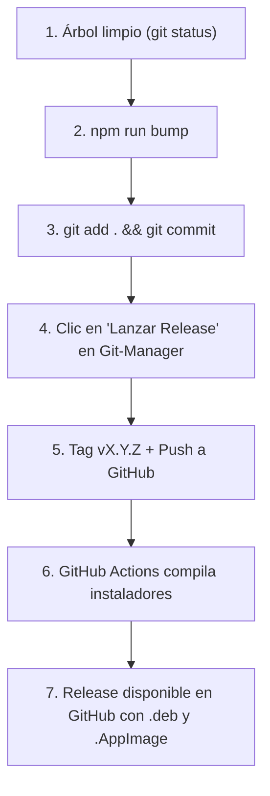

# Guía de Desarrollo, Compilación y Flujo de Releases

Esta guía describe los estándares, comandos y el flujo de trabajo oficial para desarrollar, probar, compilar y publicar versiones de **Git-Manager**.

---

## 1. Flujo Oficial para Lanzar una Nueva Versión (Release)

Git-Manager sigue el estándar de la industria (modelo GitKraken/GitHub): el código fuente y las versiones de los archivos se gestionan de forma atómica y explícita antes de crear la etiqueta de release.

### Resumen del Flujo


### Paso a Paso Detallado:

#### Paso 1: Preparación del Repositorio
Asegúrate de estar en la rama principal (`main`) y que no existan cambios pendientes sin confirmar:
```bash
git checkout main
git status
```
> [!NOTE]
> Si estuviste trabajando en `dev`, asegúrate de haber probado y preparado tus cambios antes de fusionar.

#### Paso 2: Actualización de la Versión del Proyecto
Ejecuta el script oficial de actualización indicando la nueva versión semántica:
```bash
npm run bump 0.4.0
```
Este script sincroniza automáticamente la versión en:
- `package.json`
- `src-tauri/Cargo.toml`
- `src-tauri/tauri.conf.json`
- `src-tauri/Cargo.lock`

#### Paso 3: Confirmar los Cambios (Commit de Release)
Realiza el commit correspondiente para fijar la versión en el historial de Git:
```bash
git add package.json src-tauri/Cargo.toml src-tauri/tauri.conf.json src-tauri/Cargo.lock
git commit -m "chore(release): v0.4.0"
```

#### Paso 4: Publicar la Release desde Git-Manager
1. Abre **Git-Manager**.
2. En la barra superior, haz clic en el botón del **Cohete** (**Lanzar Release**).
3. El modal detectará automáticamente la versión configurada (`v0.4.0`).
4. Revisa o ajusta:
   - **Nombre de la Etiqueta:** Por defecto `v0.4.0`.
   - **Notas de la versión:** Resumen de novedades o correcciones incluidas.
   - **Subir inmediatamente a GitHub:** Activado (recomendado).
5. Haz clic en **Publicar Release v0.4.0**.

#### Paso 5: Compilación Automatizada en GitHub Actions
- La app creará la etiqueta Git anotada en `HEAD` y hará push de `main` y del tag a GitHub.
- El modal de **GitHub Actions Hub** se abrirá automáticamente para que puedas monitorear en tiempo real la ejecución del pipeline.
- Al finalizar el job, GitHub publicará los binarios en la pestaña de [Releases de GitHub](https://github.com/juanesscort/git-manager/releases).

---

## 2. Comandos para Probar y Desarrollar en Local

### Entorno de Desarrollo
Para arrancar la aplicación en modo desarrollo (con recarga rápida en el frontend y recompilación de Tauri):
```bash
npm run tauri dev
```

### Pruebas Unitarias del Core en Rust
Ejecuta la suite de pruebas unitarias (staging, diffs, ramas, tags, 3-way merge, asistente IA y releases) utilizando repositorios temporales aislados:
```bash
cargo test --manifest-path src-tauri/Cargo.toml
```

### Calidad de Código y Linters
Antes de confirmar cambios o abrir PRs, valida la calidad del código:
```bash
# Validación de tipos TypeScript y build de Vite
npm run build

# Linter estricto de Rust (cero warnings)
cargo clippy --manifest-path src-tauri/Cargo.toml -- -D warnings

# Verificación de formateo oficial de Rust
cargo fmt --manifest-path src-tauri/Cargo.toml --check
```

---

## 3. Compilación e Instalación de la Aplicación

Existen dos alternativas para generar e instalar Git-Manager en Linux:

### Opción A: Compilación Local (.deb)
Si deseas compilar la versión de producción directamente en tu máquina local sin esperar a GitHub Actions:

```bash
# Compilar paquete .deb sin necesidad de llaves de firma privada
npm run tauri build -- --bundles deb --no-sign
```

Una vez finalizada la compilación, el archivo `.deb` se ubicará en:
```
src-tauri/target/release/bundle/deb/git-manager_0.4.0_amd64.deb
```

#### Instalación en Linux (Debian, Ubuntu, Linux Mint, Pop!_OS):
```bash
sudo dpkg -i src-tauri/target/release/bundle/deb/git-manager_0.4.0_amd64.deb
```
Si el sistema reporta dependencias pendientes del sistema:
```bash
sudo apt-get install -f
```

Ejecuta la aplicación desde la terminal con `git-manager` o búscala en el menú de aplicaciones de tu escritorio.

---

### Opción B: Descarga desde GitHub Releases (Recomendado)
Cada vez que se publica una release oficial con una etiqueta `v*.*.*`:

1. Ingresa a la sección de [Releases de Git-Manager](https://github.com/juanesscort/git-manager/releases).
2. Localiza la versión deseada (ej. `v0.4.0`).
3. En la sección **Assets**, descarga el paquete para tu distribución:
   - **`GitManager_X.Y.Z_amd64.deb`**: Para sistemas basados en Debian/Ubuntu. Instalar con `sudo dpkg -i <archivo>.deb`.
   - **`GitManager_X.Y.Z_amd64.AppImage`**: Ejecutable universal y portátil.
     ```bash
     chmod +x GitManager_X.Y.Z_amd64.AppImage
     ./GitManager_X.Y.Z_amd64.AppImage
     ```
   - **`GitManager-X.Y.Z-1.x86_64.rpm`**: Para distribuciones Fedora, openSUSE o RHEL. Instalar con `sudo rpm -i <archivo>.rpm`.
